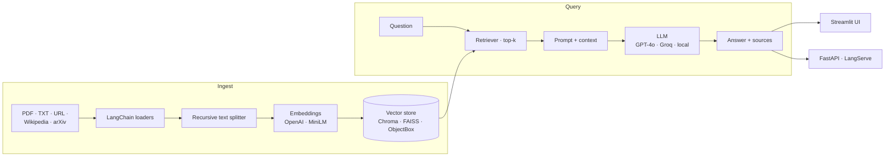

<div align="center">

# RAG Document Q&A

**Ask questions across PDFs, web pages, Wikipedia and arXiv, with answers grounded in your sources**


</div>

> **TL;DR:** A retrieval-augmented generation system where every major component can be swapped: **3 vector stores**, **cloud or local embeddings**, and **OpenAI, Groq or local LLMs**. It ships with a Streamlit UI and a FastAPI/LangServe REST API, plus a **retrieval evaluation harness**: 30 labelled questions over 1,880 passages from SEC 10-K filings (JPMorgan, Apple, Chevron, Pfizer, Walmart), measuring hit rate, MRR and latency for each vector store and embedding model.

<br>

## What it does

| | |
|:--|:--|
| **Ingest** | PDFs, text files, web URLs, Wikipedia, arXiv |
| **Ask** | Context-grounded Q&A over everything you've loaded |
| **Summarize** | Map-reduce, stuff or refine strategies for long documents |
| **Explain** | An answer walkthrough showing which chunks were retrieved and how the answer was built |
| **Evaluate** | Retrieval hit rate, MRR and p50/p95 latency on a labelled 10-K question set (`eval/`) |
| *Extra* | *Text-to-speech output of answers* |

## Architecture



## Evaluation

**Set-up.** Corpus: 1,880 passages (Business, Risk Factors and MD&A) from 10 SEC 10-K filings, two fiscal years each for AAPL, CVX, JPM, PFE and WMT. Questions: 30 hand-written questions (`eval/questions_sec10k.jsonl`), each labelled with a phrase copied verbatim from the passage that answers it. A retrieved passage counts as a hit if it contains that phrase. Latency is the vector-store search alone (20 timed searches per question, query already embedded).

**Measured (offline baseline, TF-IDF + LSA embeddings at 384 dimensions, top-5):**

| Vector store | Hit@1 | Hit@5 | MRR@5 | Search p50 | Search p95 | Index build |
|:--|--:|--:|--:|--:|--:|--:|
| **FAISS** | 50% | 63% | 0.54 | **0.14 ms** | **0.20 ms** | 0.5 s |
| Chroma | 50% | 63% | 0.54 | 1.4 ms | 1.9 ms | 2.0 s |

- **FAISS is about 10× faster than Chroma per search**, with identical results, since both run exact nearest-neighbour search at this size. At under 2 ms, though, neither is the bottleneck next to an LLM call. Chroma stays the default because it persists and filters metadata out of the box.
- **The lexical baseline misses 11 of 30 questions**, mostly paraphrases such as "which regulator supervises…" against "Office of the Comptroller of the Currency". That gap is what a semantic embedding has to close.

**To add the semantic rows** (needs network access to Hugging Face or an OpenAI key):

```bash
./eval/fetch_corpus.sh                                   # 0.5 MB, SHA-256 checked
python eval/run_retrieval_eval.py --embeddings minilm
python eval/run_retrieval_eval.py --embeddings openai    # OPENAI_API_KEY in .env
```

### Component notes (from development, not yet measured)

| Component | Options tried | Observation |
|:--|:--|:--|
| **Embeddings** | OpenAI vs sentence-transformers MiniLM | OpenAI looked better in manual checks; the harness above will put numbers on it |
| **Vector store** | ChromaDB vs FAISS vs ObjectBox | Speed measured above; ObjectBox took more set-up and isn't in the benchmark yet |
| **LLM** | OpenAI GPT-4o vs Groq vs local models | GPT-4o gave the best answers in my manual comparison; Groq responded faster; local models work offline at lower quality |
| **Chunking** | chunk size and overlap sweep | Larger chunks slowed retrieval, so chunks are kept small with some overlap |

## Quickstart

```bash
git clone https://github.com/Kunj2710/rag-document-qa && cd rag-document-qa
python -m venv venv && source venv/bin/activate
pip install -r requirements.txt
cp .env.example .env              # add your OPENAI_API_KEY
./run_streamlit.sh                # UI at http://localhost:8501
./run_api.sh                      # REST API at http://localhost:8000/docs
```

Detailed configuration and API reference: [`docs/USAGE.md`](docs/USAGE.md)

## Code map

| File | Responsibility |
|:--|:--|
| `rag_pipeline.py` | Loading, splitting, embedding, indexing |
| `query_processor.py` | Retrieval, prompting, summarization, walkthroughs |
| `streamlit_app.py` | Web UI |
| `api_server.py` | FastAPI + LangServe endpoints (SSE streaming) |
| `eval/` | Retrieval evaluation: labelled questions, corpus fetch script, metrics |
| `audio_generator.py` | Text-to-speech (optional extra) |
| `config.py` | All settings, read from `.env` |

## What I'd do next

- **Answer-level evaluation.** Retrieval is measured; next is answer faithfulness and a "not found in the documents" refusal check (RAGAS or LLM-as-judge)
- **Point it at SEC filings by default.** Cited answers plus structured extraction of key figures into a table
- **Hybrid retrieval.** BM25 + dense retrieval with a cross-encoder reranker
- **Deploy.** Docker image plus a hosted demo on Streamlit Community Cloud

<br>

<sub>📄 <a href="report/report.pdf">Project report</a> · Boston University MET CS 688, Fall 2025</sub>
