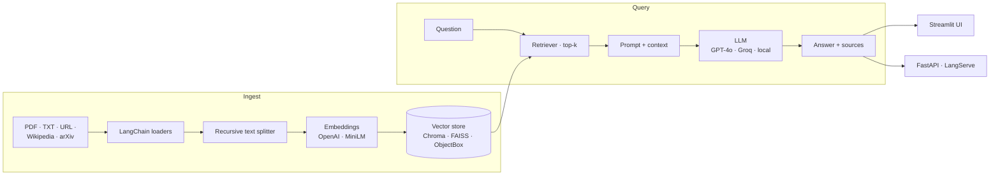

<div align="center">

# RAG Document Q&A

**Ask questions across PDFs, web pages, Wikipedia and arXiv, with answers grounded in your sources**


</div>

> **TL;DR:** A retrieval-augmented generation system where every major component can be swapped: **3 vector stores**, **cloud or local embeddings**, and **OpenAI, Groq or local LLMs**. I evaluated each option on answer quality, speed and ease of operation. It ships with a Streamlit UI and a FastAPI/LangServe REST API.

<br>

## What it does

| | |
|:--|:--|
| **Ingest** | PDFs, text files, web URLs, Wikipedia, arXiv |
| **Ask** | Context-grounded Q&A over everything you've loaded |
| **Summarize** | Map-reduce, stuff or refine strategies for long documents |
| **Explain** | An answer walkthrough showing which chunks were retrieved and how the answer was built |
| **Listen** | Text-to-speech output of answers |

## Architecture



## What I learned from evaluating each component

| Component | Options tested | Verdict |
|:--|:--|:--|
| **Embeddings** | OpenAI vs sentence-transformers MiniLM | OpenAI retrieved more relevant chunks; MiniLM is the free, offline fallback |
| **Vector store** | ChromaDB vs FAISS vs ObjectBox | **FAISS** was fastest at similarity search; **Chroma** was the most stable, so it's the default; ObjectBox is production-ready but harder to set up |
| **LLM** | OpenAI GPT-4o vs Groq vs local models | Both GPT-4o options gave the best answers; **Groq was faster**; local models work offline at lower quality |
| **Chunking** | chunk size and overlap sweep | Larger chunks slowed retrieval, so I kept chunks small with some overlap to preserve context |

## Quickstart

```bash
git clone https://github.com/Kunj2710/rag-document-qa && cd rag-document-qa
python -m venv venv && source venv/bin/activate
pip install -r requirements.txt
cp .env.example .env              # add your OPENAI_API_KEY
./run_streamlit.sh                # UI at http://localhost:8501
./run_api.sh                      # REST API at http://localhost:8000/docs
```

Detailed configuration and API reference: [`docs/USAGE.md`](docs/USAGE.md)

## Code map

| File | Responsibility |
|:--|:--|
| `rag_pipeline.py` | Loading, splitting, embedding, indexing |
| `query_processor.py` | Retrieval, prompting, summarization, walkthroughs |
| `streamlit_app.py` | Web UI |
| `api_server.py` | FastAPI + LangServe endpoints (SSE streaming) |
| `audio_generator.py` | Text-to-speech |
| `config.py` | All settings, read from `.env` |

## What I'd do next

- **Measure, don't eyeball.** Add a RAGAS / LLM-as-judge eval set (faithfulness, context recall) so component choices are backed by numbers
- **Hybrid retrieval.** BM25 + dense retrieval with a cross-encoder reranker
- **Deploy.** Docker image plus a hosted demo on Streamlit Community Cloud

<br>

<sub>📄 <a href="report/report.pdf">Project report</a> · Boston University MET CS 688, Fall 2025</sub>
